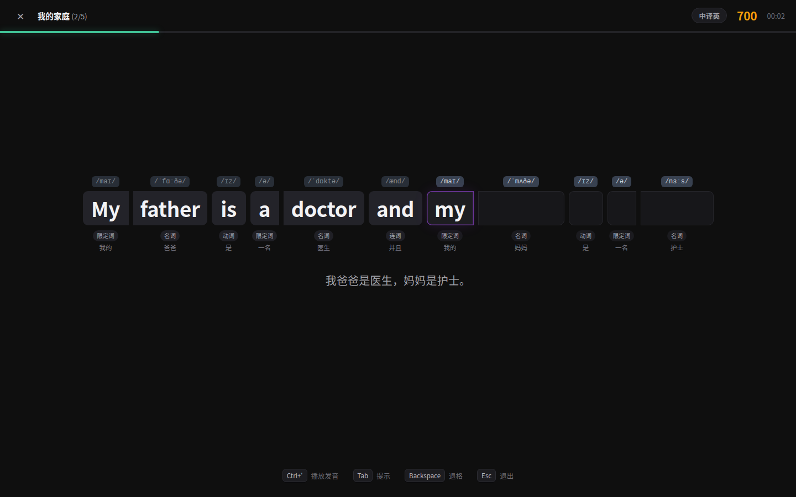
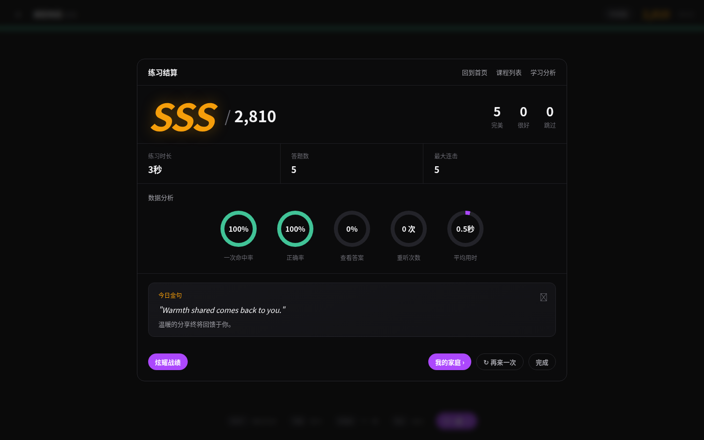
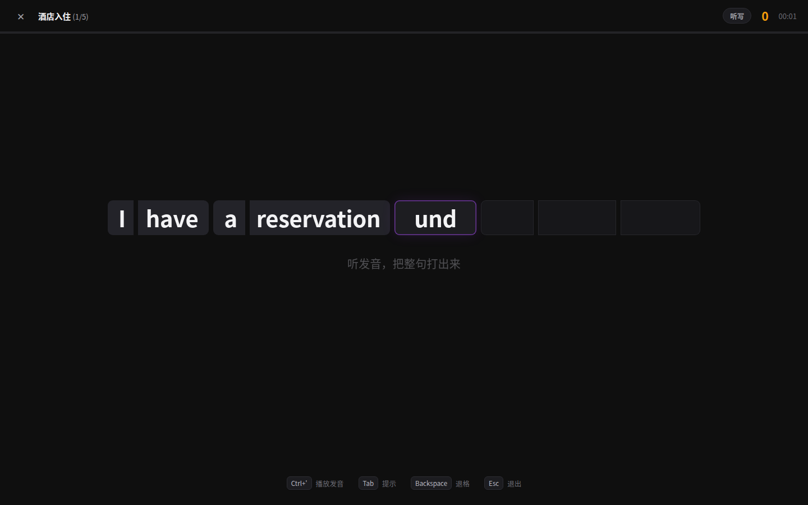
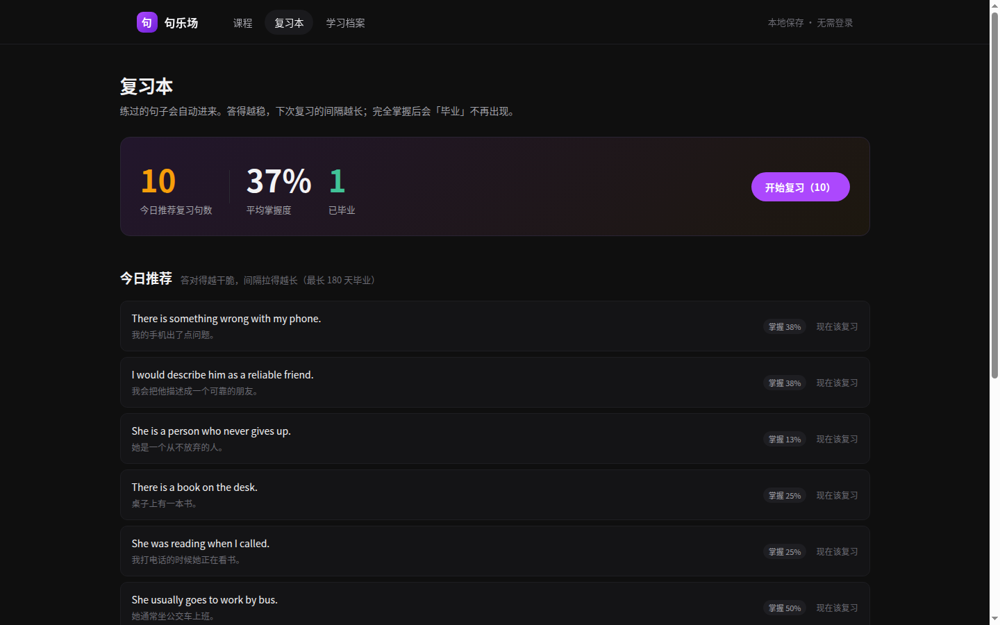

# 句乐场 · julebu.co 核心玩法复刻

用 REA（Reverse Engineering Agent）逆向 `https://julebu.co/`，把它的**核心学习闭环**复刻成一个可独立运行的网页应用。

零依赖、零构建：原生 ES Modules + 原生 CSS，`python -m http.server` 就能跑。

---

## 一、逆向过程（可复现）

REA 6.8.0 的 Web 能力链：`list-browser-targets` → `inspect-web-page` → `analyze-web-bundle` → `capture-web-screenshot`。
在 WSL 里起 headless Chrome（带 CDP），用 REA 被动观察 + 静态分析页面 bundle。

```bash
# 1. 起一个带 CDP 的浏览器
google-chrome --headless=new --remote-debugging-port=9222 --no-sandbox --user-data-dir=/tmp/rea-chrome about:blank

# 2. 打开目标站，列出页面 target
rea list-browser-targets http://127.0.0.1:9222

# 3. 被动检查页面：DOM / 资源 / 存储 key / JSON 响应形状
rea inspect-web-page http://127.0.0.1:9222 <targetId> \
    --observation-ms 3000 --include-json-body-shapes --include-storage-keys

# 4. 静态重建 JS 路由表（154 条候选）
rea analyze-web-bundle http://127.0.0.1:9222 <targetId> \
    --detail summary --evidence_output ~/rea-out/evidence.json \
    --view '{"kind":"javascript-routes","collection":"routes"}'

# 5. 截取真实界面
rea capture-web-screenshot http://127.0.0.1:9222 <targetId>
```

### 逆向结论

| 项目 | 结果 |
| --- | --- |
| 技术栈 | Nuxt 3（Vue）SPA，70 个 JS chunk，无 sourcemap |
| 核心玩法路由 | `/game/course/:coursePackId/:id` |
| 其他关键路由 | `/buddy`（学伴）、`/dynamics`（动态）、`/course-analytics/*`（学情报告）、`/affiliate`、`/docs/*`（完整帮助文档） |
| 核心机制来源 | 官方帮助文档 `/docs/guide-core-learning`、`/docs/guide-combo`、`/docs/guide-review` |
| 视觉取值 | 游戏截图采样：底色 `#0f0f0f`、金色 `#f69e0a`、紫色 `#ac48fd`、进度绿 `#41c397`、音标标签 `#384150`、词块 `#77500d #772533 #48337a #0a5a68` |

站内的 `/docs/*` 是完整的功能说明书，比猜机制可靠得多，所有规则都按它实现。

### 实际界面

| 练习（连击弹窗） | 结算面板 |
| --- | --- |
|  |  |

| 听写模式 | 复习本 |
| --- | --- |
|  |  |

---

## 二、复刻的核心功能

### 1. 打字练习引擎（中译英 / 听写）

- 屏幕只给中文 + 逐词音标 / 词性 / 释义，**拼写要自己打出来**（这是原站的关键设计：给读音和意思，不给拼写）。
- **每个单词一个输入框**：词块本身就是输入框，切题时光标自动落在第一个词，答对自动跳到下一个词，全程不用点鼠标。
- 逐词输入：字母累积 → 空格/回车提交当前词 → 对了词块填充并锁定 → **错了只有提交那一下该词块标红抖动**（420ms 后自动清空重打），不会整屏花花绿绿。
- 空着退格会退回上一个词重打；Tab 逐字母提示当前词。
- 词块统一配色（不再逐词一色）：当前词紫色描边、已完成灰底、未开始空槽位；语块圆角仍然保留。
- 单词上方音节、下方词性胶囊与释义，版式对齐原站。
- 听写模式：隐藏全部文字提示，进入句子自动朗读，靠耳朵还原整句。

### 2. Perfect / Great 判定（对齐官方规则）

| 评价 | 条件 | 处理 |
| --- | --- | --- |
| Perfect | 首答正确、没按过退格、没用提示 | 连击 +1，满分 |
| Great | 首答正确，但中间退格修改过 | 连击 +1，分数 ×0.9 |
| 普通 | 首答错过，或用了提示 | 连击清零，分数 ×0.5 |
| 跳过 | 直接看答案 | 连击清零，0 分 |

### 3. 连击加成 + SSS 评级

连击档位（来自原站文档，一字不差）：

```
≥3 次 +10%   ≥5 次 +20%   ≥7 次 +30%
≥10 次 +50%  ≥15 次 +80%  ≥20 次 翻倍
```

单题得分 = `词数 × 100 × 质量系数 × 连击系数`，整场汇总后按首答率/正确率给 **C → B → A → S → SS → SSS**。
连击 ≥3 时屏幕中央弹出金色 `Perfect × N` 动画 + 随连击升调的合成音效。

### 4. 结算面板

评级大字、总分、完美/很好/跳过计数、练习时长/答题数/最大连击、五项环形数据分析（一次命中率、正确率、查看答案、重听次数、平均用时）、今日金句、炫耀战绩（复制文案）——版式对照原站截图还原。

### 5. 间隔重复复习本（SRS）

- 练过的句子自动进入复习池，按表现调度：Perfect 跳两级、Great 跳一级、用提示原地重复、跳过/答错打回重来（10 分钟后重现）。
- 间隔阶梯 `1 / 2 / 4 / 7 / 15 / 30 / 60 / 120 / 180 天`，拉到 180 天即「毕业」不再推荐；毕业后又答错会自动复活。
- 首页/复习本显示今日推荐数量，一键开始复习；每句显示掌握度百分比与下次到期时间。

### 6. 学习档案

已追踪句子、平均掌握度、今日待复习、已毕业数、完成次数、累计时长；课程进度按最佳评级展示；偏好设置（连击动画 / 音效 / 音标 / 朗读语速）；一键清空。

### 7. 课程包体系（题材参考 /mall 课程包商城）

原站 `/mall` 是课程包商城，需要登录（未登录直接跳 `/login` + 微信扫码），所以内容是抓不到的；但它的分类逻辑在帮助文档里写得很清楚：**按人群和场景分包，每包前几节免费试学**——教材同步、四六级、雅思、PTE、考研、商务英语、日常口语。

按这个思路做了 4 个新包（`src/data/packs-extra.js`），每个包 2–3 节课、每节 4–5 句：

| 包 | 标签 | 课程 | 例句风格 |
|---|---|---|---|
| 教材同步 | 小学 | 课堂用语 · 我的家庭 | `May I come in?` / `I don't understand this word.` |
| 旅行英语 | 实用 | 机场出行 · 酒店入住 · 问路与交通 | `My flight has been delayed for two hours.` |
| 职场商务 | 职场 | 日常办公 · 求职面试 | `Let's schedule a meeting for Friday afternoon.` |
| 四六级核心 | 备考 | 高频句型 · 写作万能句 | `There is no doubt that hard work pays off.` |
| 语法精讲 | 核心 | There be · 时态 | 原有 |

合计 **8 个包 / 20 节课 / 97 句**，每句逐词带音标、词性、释义、语块编号。

### 8. 词汇拓展（从 /learn 逆向来的学习资源）

原站 `/learn` 是词汇学习频道，30 个主题分类、1022 个词条，每条都带音标 / 词性 / 中文 / 例句 / 场景句 / 搭配。Nuxt 把每个分类预渲染成静态 `_payload.json`，可直接抓取。

- 完整提取件：`docs/learn-resources.json`（30 分类 · 1022 词，devalue 解码后结构化成 JSON）
- 已转成课程：`src/data/vocab.js` —— 6 节课 / 30 句（食物 · 动物 · 身体 · 天气 · 情绪 · 水果），每句取原站词条例句（原句原翻译），逐词音标 / 词性 / 释义由 AI 补全标注
- 每个分类对应原站一个 slug（`food` / `animals` / `body` / `weather` / `emotions` / `fruits`），后续想扩课直接从提取件里取，不用再抓

### 9. 音频

- 发音：浏览器内置 Web Speech API，可选美音，语速 0.5x–2.0x。
- 音效：WebAudio 实时合成（打字、敲对、敲错、连击、结算），**不依赖任何音频文件**。

---

## 三、运行

```bash
# 方式一：任意静态服务器
python3 -m http.server 8080
# 浏览器打开 http://localhost:8080

# 方式二：如果装了 Node
npx serve . -l 8080
```

> 必须通过 http 打开。`file://` 下 ES Modules 会被 CORS 拦截。

### 快捷键

| 键 | 作用 |
| --- | --- |
| 字母 / 空格 | 输入 / 提交当前词 |
| `Enter` | 提交 / 下一题 |
| `Backspace` | 退格（回退到上一个词也可以） |
| `Tab` | 提示，逐字母揭示（**会断连击**） |
| `Ctrl + '` | 播放发音 |
| `Esc` | 退出 |

---

## 四、测试

```bash
node --test test/engine.test.mjs
```

16 个用例覆盖：连击档位、得分公式、评级阈值、SRS 推进/毕业/复活/队列挑选、打字引擎四种判定路径、提示逐字母、大小写与标点容错，以及课程数据完整性（词表必须能拼回原句、音标格式、语块编号单调）。

另外用 CDP 做过端到端验证：模拟键盘打完整节课 → 断言结算为 `SSS / 2,580 / 5 完美 / 最大连击 5`，无控制台报错。

---

## 五、目录结构

```
index.html              应用外壳
src/
  main.js               hash 路由与启动
  store.js              localStorage 持久化（进度 / SRS / 设置 / 统计）
  dom.js                极简 DOM 构造器
  styles.css            设计系统（配色采样自原站）
  core/
    typing.js           逐词输入判定引擎
    scoring.js          连击加成 / 得分 / 评级
    srs.js              间隔重复调度
    speech.js           Web Speech TTS
    sfx.js              WebAudio 合成音效
  data/courses.js       课程包集合（合并入口 + 基础三包）
  data/packs-extra.js   拓展包：教材同步 / 旅行 / 职场 / 四六级（题材参考 /mall）
  data/vocab.js         词汇拓展包：6 节课 / 30 句（源自 /learn 逆向资源）
docs/learn-resources.json  逆向提取的完整词汇资源（30 分类 · 1022 词）
  views/
    home.js  practice.js  review.js  profile.js  nav.js
test/engine.test.mjs    核心逻辑测试
```

---

## 六、有意没做的部分

原站还有这些功能，不在「核心玩法」闭环里，本次未实现：

- **账号体系与云同步**（本站全部走 localStorage）
- **AI 英语老师答疑**（需接 LLM）
- **编辑端**（上传课文 → AI 自动拆句/翻译/生成讲解）
- **口语测评**（需 ASR 打分）、听力三阶段、视频/音乐课程
- **学伴 / 组队 / PK 排行榜 / 金币任务 / 会员支付**

如果需要，`core/typing.js` + `core/srs.js` 是干净的接缝：新增模式只需换渲染层，不必改判定与调度。

---

## 七、说明

本项目为技术研究与学习用途，机制与视觉参考 `julebu.co`，课程句子为自撰示例内容。原站的品牌、文案、课程素材版权归其所有，请勿直接商用。
